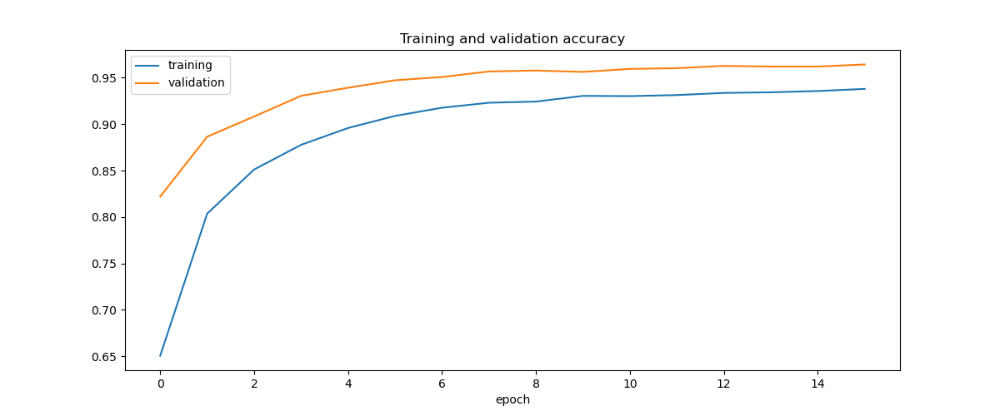
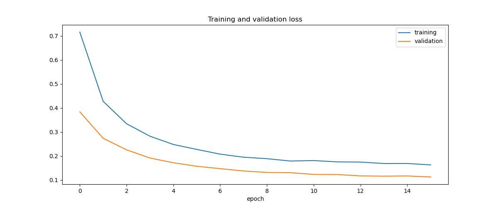
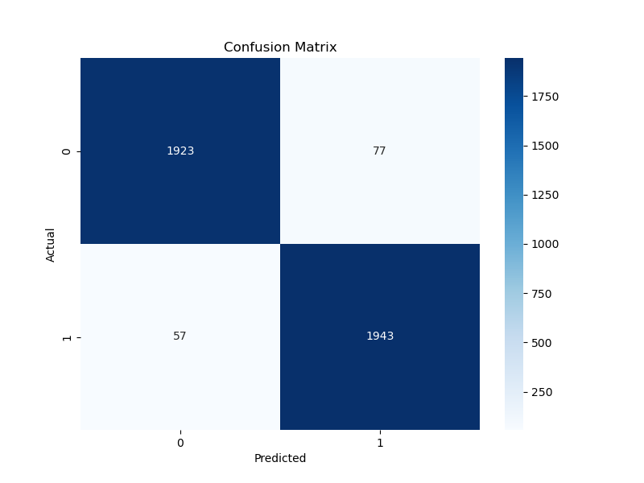

# Violence Detection in Videos

This project implements a real-time violence detection system using MobileNetV2, a lightweight convolutional neural network architecture. The system analyzes video frames and classifies content as either "Violence" or "Non-Violence" with high accuracy.

## Overview

The violence detection system works by:

1. Extracting frames from videos
2. Processing frames through a trained MobileNetV2 model
3. Classifying each frame as violent or non-violent
4. Providing real-time visual feedback on processed videos

## Data Collection

The data used was data provided by Kaggle. The data is largely divided into Violence and NonViolence for 1000 images each.

[Real Life Violence Situations Data](https://www.kaggle.com/mohamedmustafa/real-life-violence-situations-dataset)

## Model

MobileNetV2 is used to with improved accuracy and predictions. It was chosen in order to be deployed for Raspberry Pi and Android.

## Project Structure

```
.
├── data/                            # Directory for extracted frames
│   ├── Violence/                   # Frames from violent videos
│   └── NonViolence/                # Frames from non-violent videos
├── model/                          # Directory for saved models (one subfolder per variant)
│   ├── base/                       # Baseline model: model.h5, ModelWeights.h5, violence_model.tflite
│   ├── 20k/                        # Trained on 20k frames
│   └── all_224/                    # Trained on the full dataset at 224x224
├── input/                          # Directory for videos to be processed
├── output/                         # Directory for processed output videos
├── logs/                           # Serves for monitoring and visualizing the model
│   ├── fit                         # Timestamped log directory
├── images/                         # Training visualizations
│   ├── accuracy.png                # Training/validation accuracy graph
│   ├── loss.png                    # Training/validation loss graph
│   └── confusion_matrix.png        # Confusion matrix visualization
├── mobilenetv2-model.ipynb         # Model training notebook
├── extract_frames_from_video.ipynb # Script to extract frames from videos
├── predict_video.ipynb             # Script to process and analyze videos
├── environment.yml                 # Conda environment specification
├── requirements.txt                # Python dependencies (pip)
├── env_requirements.txt            # Pinned pip dependencies (exact versions)
└── README.md                       # This file
```

> **Note:** The `data/`, `model/`, `input/`, `output/`, and `logs/` directories hold datasets, trained
> weights, and generated artifacts. They are excluded from version control via `.gitignore` — create them
> locally when preparing data or running the notebooks.

## Performance

The trained model achieves:

- **Overall accuracy**: ~96.6%
- **Violence detection accuracy**: ~96.1%
- **Non-violence detection accuracy**: ~97.1%





## Output

Output is in the form of a video, which will tell violence/ non-violence on the top left corner.


## How to Start

### Prerequisites

- Python 3.10
- TensorFlow 2.19.0
- Keras 3.12.1
- OpenCV 4.8.1
- NumPy 1.26.4
- Pandas 2.2.3
- Matplotlib 3.10.0
- scikit-learn 1.6.1
- scikit-image 0.24.0
- imgaug 0.4.0
- imutils 0.5.4
- CUDA Toolkit 11.2 with cuDNN 8.1.0 (for GPU acceleration)

### Installation

```bash
# Clone the repository
git clone https://github.com/yourusername/violence-detection.git
cd violence-detection

# Option 1: Using pip
pip install -r requirements.txt

# Option 2: Using conda
conda env create -f environment.yml
conda activate CCDEPLRL_PROJECT
```

### Docker (GPU environment)

The Docker setup gives a container with TensorFlow 2.19 (GPU build) and JupyterLab.

- Host needs: an NVIDIA GPU driver and Docker Desktop with GPU support (NVIDIA Container Toolkit).
- Start: `docker compose up --build`, then open http://localhost:8888/lab.
- Access: JupyterLab asks for no token or password.
- Security: the port is bound to 127.0.0.1, so only this computer can reach Jupyter.
- Files: the repo folder is mounted at `/workspace`. Edits in the container change the real files.
- GPU access inside the container is not tested.

### Data Preparation

1. Place violence and non-violence videos in the kaggle dataset in their respective directories under `video/`
2. Run the frame extraction Jupyter Notebook

### Training the Model

1. Run the mobilenetv2 Jupyter Notebook

### Processing Videos

1. Place videos to be analyzed in the `input/` directory
2. Run the prediction script:
3. Run the frame extraction Jupyter Notebook
4. Processed videos will be saved in the `output/` directory

## Model Architecture

The system uses MobileNetV2 with the following modifications:

- Input shape: 128x128x3 (Also change the predict_video image size to match the model)
- Global Average Pooling
- Dropout (0.4) for regularization
- Dense output layer with sigmoid activation
- L2 regularization (0.0005)
- Binary cross-entropy loss function
- Adam optimizer with dynamic learning rate

## Performance Optimization

- Resizing image from 128 to 224/256 (Also change the predict_video image size to match the model)
- Batch size can be increased from 32 to 64/128 (speeds up epoch)
- Change the alpha parameter from 0.75 to 1.0 (to utilize full model)
- Change the layer.trainable from false to true (to help fine tuning the model)
- Utilize the full dataset from 10000 to all the extracted frames (more date better generalization)
- Increase patience from 5 to 10-20 (better converge)
- Increase epoch from 50 to between 50-100 (better converge)

## Known Issues in This README

Parts of this README do not match the current code.

- Image size: "Model Architecture" says 128x128. `mobilenetv2-model.ipynb` uses 224x224 (`IMG_SIZE = 224`). `mobilenetv2-mode_ORIGINAl.ipynb` uses 128x128.
- Sample count: "Performance Optimization" says 10000 samples. In `mobilenetv2-model.ipynb` the `MAX_SAMPLES_PER_CLASS = 20000` line is commented out, so the active generator uses all frames. `mobilenetv2-mode_ORIGINAl.ipynb` caps at 10000 per class.
- Project Structure: the tree does not list `mobilenetv2-mode_ORIGINAl.ipynb`, `Dockerfile`, `docker-compose.yml` or `.dockerignore`.
- Source videos: the frame extraction notebook reads `video/Violence` and `video/NonViolence`. The tree does not show `video/`. Git ignores this folder.
- Processing Videos: step 2 is incomplete. Step 3 should say `predict_video.ipynb`, not the frame extraction notebook.
- Output GIF: Git ignores `output/Output.gif`, so the image in "Output" does not show in the online repository.
- Clone URL: `yourusername/violence-detection` is a placeholder.
- Python version: Prerequisites list Python 3.10. The Docker image uses Python 3.11.

## Review notes (2026-10-18)

Code review of branch `additional`. `[ran]` = seen when running a copy of the notebook on CPU. `[read]` = found by reading the code. The code is not changed.

1. `mobilenetv2-model.ipynb` cell 12 uses `X_original`, which only exists in a commented-out cell. "Run All" stops with `NameError` before training. [ran]
2. Training saves `model/model_all_224.h5`. `predict_video.ipynb` loads `model/all_224/model_all_224.h5`. After a new training run, the file must be moved by hand. [read]
3. `process_video(display=True)` calls `cv2.imshow`. The Docker image installs `opencv-python-headless`, so display fails in Docker. Use `display=False` there. [read]
4. `LearningRateScheduler` sets the learning rate at the start of each epoch, and `lrfn` ignores the current rate. So it cancels every cut from `ReduceLROnPlateau`. [read]
5. The validation set is also the model-selection set (checkpoint, early stopping) and the reported test set. There is no held-out test set, so the ~96.6 % accuracy is optimistic. [read]
6. `get_best_epoch` matches `val_loss` rounded to 2 decimals, so it can return the wrong epoch. `np.argmin(history.history['val_loss'])` is exact. [read]
7. Inputs are scaled to [0, 1]. The ImageNet weights of MobileNetV2 expect [-1, 1] (`preprocess_input`). Train and predict use the same scaling, so there is no mismatch, but transfer is weaker. [read]
8. `mobilenetv2-mode_ORIGINAl.ipynb` trains on BGR frames (`cv2.imread`), but `predict_video.ipynb` feeds RGB. Its split is per frame, not per video, so near-identical frames are in train and test and the test score is inflated. [read]
9. `requirements.txt` has no OpenCV. `environment.yml` pins CUDA 11.2 / cuDNN 8.1, but TensorFlow 2.19 needs CUDA 12. [read]
10. `extract_frames_from_video.ipynb` stops with `NameError: video_files` when `video/` is missing. [ran]

Not tested: training (dataset and `video/` not on disk, GPU needed), Docker (daemon off) and `display=True`. `predict_video.ipynb` ran top to bottom with `display=False`.
